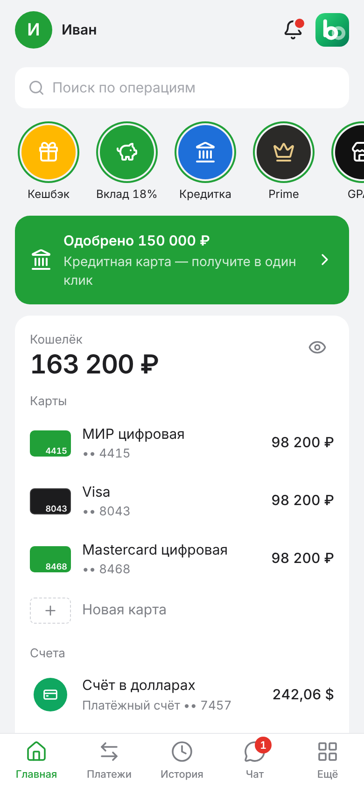
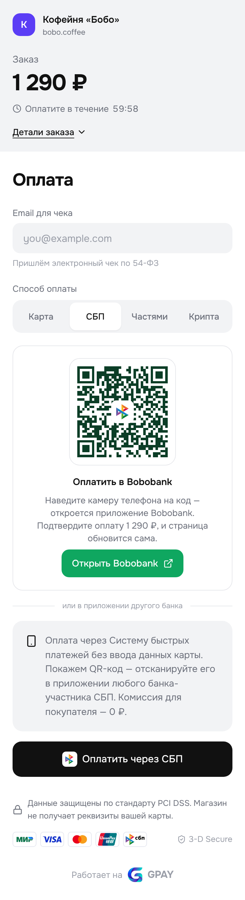

<p align="center"></p>

# Bobobank — игровой банк

Банк с игровыми деньгами для того же сервера, что портал и GPAY. Двойная запись по счетам, карты МИР / Visa / Mastercard / UnionPay, переводы, вклады, кредиты со скорингом, кешбэк, поддержка и полноценная админка. Карты банка принимаются в GPAY, а выручка магазинов GPAY выплачивается на счета в Bobobank.

<p align="center">
  
  
</p>

## Возможности

| Раздел | Что умеет |
|---|---|
| **Регистрация** | По номеру телефона; код из «СМС» приходит уведомлением на экране. Сразу открываются рублёвый счёт и бесплатная виртуальная карта МИР. |
| **Карты** | Дебетовые (виртуальные и пластиковые), кредитные, детские, Prime. Своя платёжная система на выбор, 8 дизайнов, реквизиты с CVC по кнопке, заморозка, лимит в месяц, оплата в интернете вкл/выкл, подтверждение покупок в приложении, перевыпуск. |
| **Счета** | Платёжные в ₽ / $ / €, накопительный, вклады, бизнес-счёт ИП / ООО. Номера счетов с контрольным ключом по БИК, реквизиты и выписки в PDF. |
| **Переводы** | По номеру телефона (с проверкой получателя «Мария С.»), по номеру карты, между своими счетами, по реквизитам. Бесплатно до лимита тарифа, дальше 1 %. Чек по каждой операции в PDF. |
| **Обмен валют** | Курс ЦБ ± спред банка, предпросмотр результата. |
| **История и аналитика** | Лента с поиском и фильтрами, группировка по дням, «ожидает списания» для холдов; расходы по категориям (кольцевая диаграмма), полгода по месяцам. |
| **Бобобонусы** | Кешбэк за покупки по MCC, 3 категории повышенного кешбэка на месяц, обмен на рубли. Prime: 1,5 % на всё и 7 % в категориях. |
| **Вклады** | Ставки по срокам, ежедневная капитализация, досрочное закрытие с потерей процентов, выплата по окончании срока. |
| **Кредиты** | Кредит наличными (аннуитет, график, автосписание, просрочка с пенями, досрочное погашение) и кредитная карта (120 дней без процентов, выписка, минимальный платёж, штраф). Автоскоринг за несколько секунд: доход за 30 дней, стаж, долговая нагрузка, просрочки; спорные заявки уходят специалисту. |
| **Ограничения** | Арест суммы на счёте, запрет списаний, полная блокировка с картами — с основанием (ФССП, ФНС, 115-ФЗ, суд и т. п.). Клиент видит баннер и сообщение в чате. |
| **Поддержка** | Чат в приложении; рабочее место оператора с карточкой клиента и шаблонами ответов (роль «Поддержка»). |
| **Админка** `/admin` | Сводка и счета банка, клиенты, начисления и списания, аресты и блокировки, блокировка карт и входа, роли, заявки на кредит, ставки, курсы, пороги скоринга, проводки, журнал действий. |

## Приложение на телефоне

Банк можно добавить на экран «Домой» и открывать как приложение: на весь экран, без адресной строки, со своей иконкой. На iPhone откройте сайт в Safari, нажмите «Поделиться» и выберите «На экран „Домой“» (на главной и в профиле есть подсказка). На Android Chrome предложит установить приложение сам или по кнопке в профиле. Нужен HTTPS (на сервере он уже есть). В приложении один раз входят по номеру и паролю.

## Бобуслуги и биржа

Если рядом установлены [Бобуслуги](https://github.com/bobopsya/bobuslugi) (`deploy/install-bobuslugi.sh`), банк становится частью игровой экономики:

- **Вход и паспорт.** Кнопка «Войти через Бобуслуги». Новый счёт открывается только по действующему Бобопаспорту, ФИО и дата рождения берутся из него. Старые клиенты подключают Бобуслуги в профиле; без этого нельзя открывать новые счета, карты и кредиты.
- **Бизнес.** Бизнес-счёт открывается по ИП или компании из реестра Бобуслуг, название и ИНН подставляются сами.
- **Штрафы и налоги.** Их можно оплатить рублями по курсу псякоина. Деньги уходят в казну страны (счёт в банке, его видит президент) или истцу по решению суда.
- **Псякоины.** Обмен на рубли и обратно со спредом 1 %.
- **Поручения государства.** Арест, снятие ареста, взыскание и зарплаты госслужащих из казны. Банк забирает их с Бобуслуг раз в 15 секунд.
- **Выписки и справки.** Бобуслуги показывают счета, выписку и справку о доходах через `/api/gos/v1` (CORS только для их сайта, вход по токену Supabase).

**Биржа** («Ещё → Инвестиции»):
- семь вымышленных компаний Асея, цена меняется каждые 5 секунд;
- цена тянется к справедливой: у Бобобанка она зависит от денег клиентов, у GPAY от оборота, у магазинов после IPO — от их оборота;
- каждая сделка сразу двигает цену: покупка вверх, продажа вниз. Инерции нет, поэтому купить и сразу продать дороже не получится;
- комиссия 0,3 %;
- в админке можно остановить торги, поменять волатильность или провести IPO магазина GPAY.

## Связка с GPAY

- **Оплата картой Bobobank.** Страница оплаты GPAY знает хеши карт банка (номера не из списка не уходят на сервер). GPAY запрашивает авторизацию в банке; банк проверяет срок, CVC, статус карты, ограничения, лимит и баланс. Если включено подтверждение, клиент видит в приложении окно «Подтвердите покупку», а страница оплаты ждёт. Двухстадийные платежи — холд, списание или отмена по команде GPAY. Возвраты приходят на карту.
- **СБП.** QR-код на странице оплаты открывает заказ в Bobobank; после подтверждения деньги списываются со счёта и платёж в GPAY сразу успешен.
- **Выплаты.** На счёте в банке — кнопка «Подключить магазин GPAY» с одноразовым кодом; в настройках магазина GPAY код вводится, и деньги Bobobank выводятся на этот счёт мгновенно.
- **Только деньги банка.** GPAY принимает только деньги Bobobank: карту банка, СБП из приложения и Bobo Pay (кнопкой или запросом по номеру телефона). Выручка выводится на счёт в Bobobank. Тестовых карт нет, поэтому «напечатать» деньги нельзя.
- Банк и GPAY общаются только по внутренней сети docker, каждый запрос подписан HMAC-SHA256 (`X-Bank-Signature: t=…,v1=…`) общим секретом `BANK_GPAY_SECRET`; снаружи пути `/internal/*` закрыты.

## Как устроено

```
bobobank/
  server/   Fastify + SQLite (шифрование BANK_DB_KEY), zod, argon2, pdfkit
    src/domain/   ledger (двойная запись, холды, ограничения), cards, transfers, fx, credit (вклады, кредиты, скоринг),
                  bonus, acquiring (авторизации для GPAY), support, tick
    src/routes/   client, sbp, support, admin, internal (API для GPAY)
  web/      React + TypeScript + Tailwind + lucide-react, шрифт Manrope
  e2e/      Playwright: регистрация → зарплата → оплата в GPAY картой → подтверждение → возврат → выплата → СБП
```

Каждое движение денег — транзакция из проводок, сумма которых в каждой валюте равна нулю; у банка свои системные счета (капитал, комиссии, проценты, расчёты с GPAY, валютная позиция, бонусы). Тесты проверяют этот инвариант после каждого сценария.

## Установка на сервер

GPAY должен быть уже установлен (`deploy/install-gpay.sh`).

```bash
./deploy/install-bobobank.sh                              # адрес bank.<домен портала>
BANK_DOMAIN=bank.example.com ./deploy/install-bobobank.sh
```

Скрипт добавит в `.env` ключи `BANK_DB_KEY`, `BANK_GPAY_SECRET` и адреса, включит профили `gpay` и `bobobank`, перезапустит GPAY уже с подключённым банком, выпустит HTTPS-сертификат и создаст администратора по номеру телефона. Обновление — общим `./deploy/update.sh`.

Команды в контейнере (`docker compose exec bobobank node dist/cli.js …`): `create-admin <телефон> "<Имя>"`, `reset-password <телефон>`, `has-admins`.

## Локально

```bash
cd bobobank/web && npm ci && npm run build
cd ../server && npm ci && npm run build
DATA_DIR=./data WEB_DIST=../web/dist COOKIE_SECURE=0 \
GPAY_INTERNAL_URL=http://127.0.0.1:8081 GPAY_PUBLIC_URL=http://localhost:8081 BANK_GPAY_SECRET=dev \
node dist/index.js                                   # http://localhost:8082
```

GPAY для связки запускается с `BANK_INTERNAL_URL=http://127.0.0.1:8082 BANK_PUBLIC_URL=http://localhost:8082 BANK_GPAY_SECRET=dev`.

Проверки: `npm --prefix bobobank/server test && npm --prefix bobobank/web test`, сквозной тест — `BANK_ADMIN_PHONE=… BANK_ADMIN_PASSWORD=… npx playwright test -c bobobank/playwright.config.ts` при запущенных банке и GPAY.

Логотипы платёжных систем — те же, что в GPAY (Simple Icons, Wikimedia Commons), иконки — Lucide, шрифт — Manrope (SIL OFL). Товарные знаки принадлежат их владельцам.
