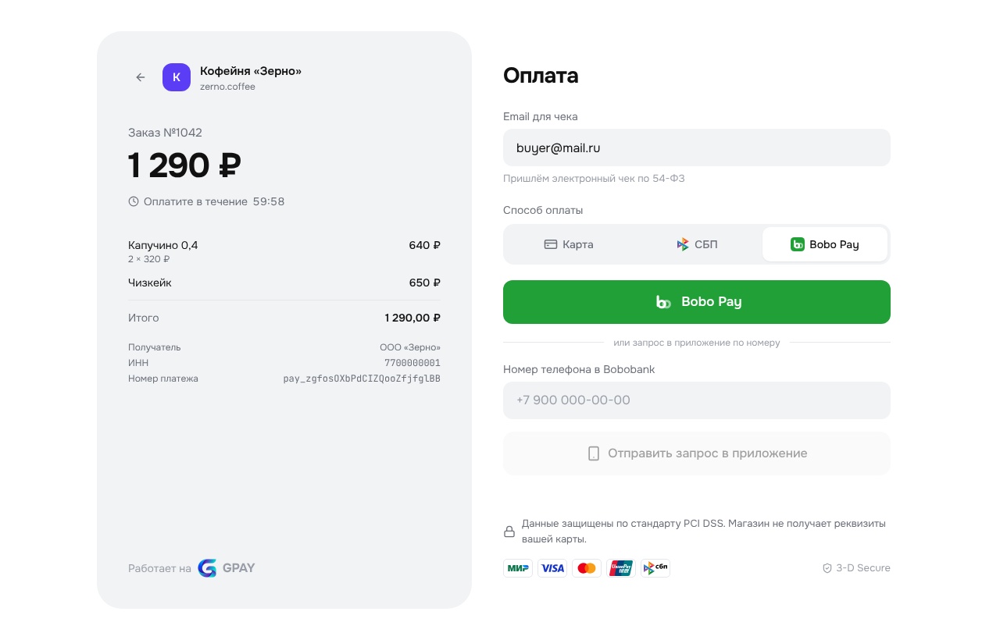
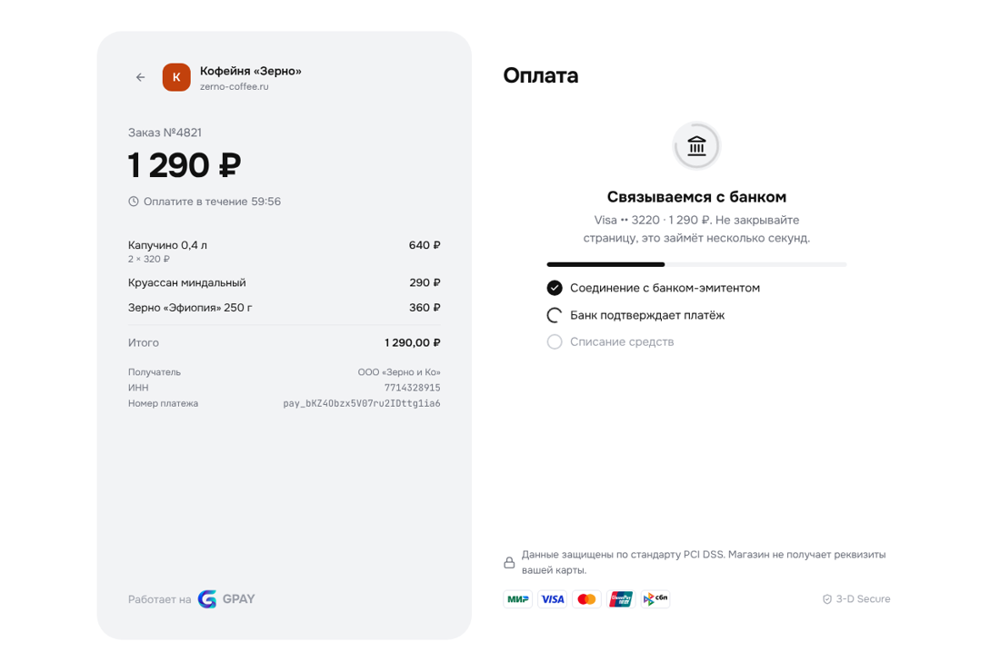
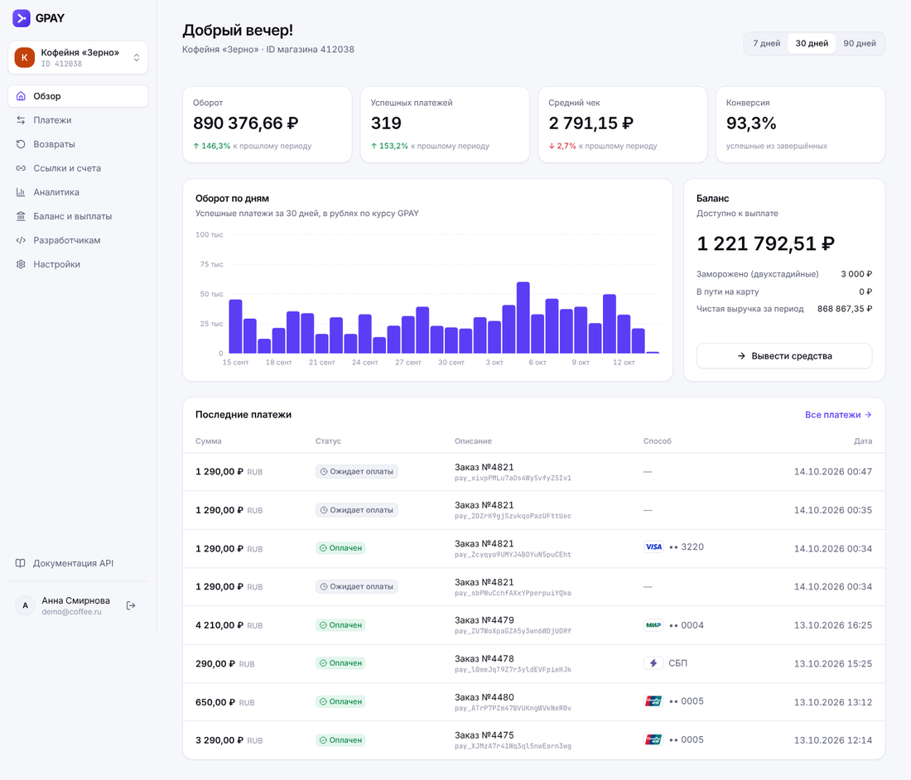
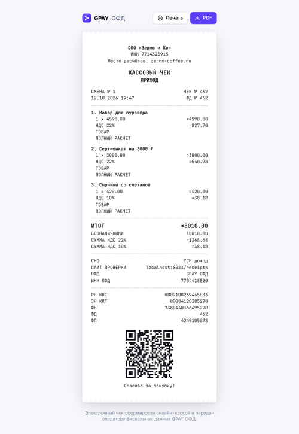
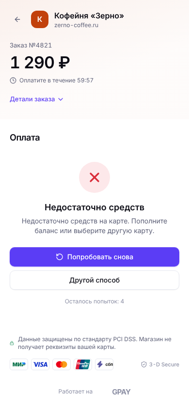

<p align="center"></p>

# GPAY (GnusaPay) — игровая платёжная система

Платёжный сервис для игры: эквайринг со страницей оплаты, онлайн-касса с чеками по образцу 54-ФЗ, ссылки и счета на оплату, REST API с вебхуками, виджет для сайтов, кабинет продавца и админка. Реальные деньги не двигаются: GPAY принимает только деньги игрового банка [Bobobank](../bobobank/README.md) — его карту, СБП из приложения банка и Bobo Pay.

<p align="center"></p>

<p align="center">
  
  
</p>
<p align="center">
  
  
</p>

## Возможности

| Раздел | Что умеет |
|---|---|
| **Страница оплаты** `/pay/:id` | Карта Bobobank (МИР / Visa / Mastercard / UnionPay) с маской и проверкой Луна, покупку подтверждают в приложении банка; СБП по QR-коду, который открывает заказ в Bobobank; Bobo Pay — кнопкой или запросом в приложение по номеру телефона; email для чека; таймер оплаты; экраны успеха, отказа с причиной и «Попробовать снова»; возврат в магазин; мобильная версия. |
| **Чеки** | Кассовый чек «Приход» и «Возврат прихода» с позициями, НДС, СНО, РН ККТ, ФН, ФД, ФП и QR-кодом; квитанция об оплате; печать и PDF. |
| **Ссылки и счета** `/l/:slug` | Фиксированная или свободная сумма, многоразовые и одноразовые, счета с позициями и плательщиком, срок действия, статистика переходов и оплат, QR-табличка для кассы. |
| **Кабинет продавца** `/app` | Регистрация, несколько магазинов, обзор с графиком оборота, платежи с фильтрами, поиском и экспортом CSV, карточка платежа с историей, списание/отмена двухстадийных платежей, полный и частичный возврат, аналитика (способы, статусы, причины отказов, валюты), баланс по валютам и выплаты, настройки способов оплаты, НДС по умолчанию, реквизиты. |
| **Разработчикам** | Секретные ключи `sk_live_…`, вебхуки с подписью HMAC-SHA256, тестовая отправка, журнал доставок с повторной отправкой, журнал запросов к API. |
| **REST API** `/api/v1` | Платежи (одно- и двухстадийные), возвраты, чеки, ссылки на оплату, выплаты; обязательный `Idempotence-Key`; курсорная пагинация; ошибки в едином формате. |
| **Документация** `/docs` | Все методы с примерами на cURL, Node.js, Python и PHP, проверка подписи вебхука, песочница запросов со своим ключом. |
| **ИИ-агентам** `/llms.txt` | Инструкция по подключению для ИИ-агентов в формате [llms.txt](https://llmstxt.org): `/llms-full.txt` — один Markdown-файл с пошаговой интеграцией, справочником API, проверкой вебхуков, кодом на Node.js/Python/PHP и чек-листом; адрес сайта и комиссии подставляются из базы. В документации — готовый запрос для агента. |
| **Виджет** `/gpay.js` | `GPAY.checkout({ paymentId })` — оплата во всплывающем окне на сайте продавца; кнопка `<gpay-button>`. |
| **Админка** `/admin` | Оборот и доход GPAY, блокировка магазинов и пользователей, индивидуальные комиссии, все платежи, курсы ₽/$/€/USDT/BTC, стандартные комиссии, журнал действий. |

## Bobobank

GPAY работает только вместе с игровым банком [Bobobank](../bobobank/README.md): без подключённого банка API отвечает `503 bank_unavailable`. Покупатель платит одним из трёх способов:

| Способ | `payment_method.type` | Как проходит |
|---|---|---|
| Карта Bobobank | `bank_card` | Номер проверяется по списку карт банка ещё в браузере (по SHA-256), чужие карты на сервер не уходят. Банк проверяет баланс и лимиты; покупку подтверждают в приложении. |
| СБП | `sbp` | QR-код открывает заказ в приложении Bobobank, оплата — с любого счёта. |
| Bobo Pay | `bobopay` | Кнопка «Bobo Pay» открывает заказ в банке; или покупатель вводит номер телефона и подтверждает запрос в приложении (5 минут). |

Возвраты возвращают деньги на ту же карту или счёт. Выручка выводится только на счёт Bobobank, подключённый кодом из приложения банка в настройках магазина. Чтобы проверить интеграцию, зарегистрируйтесь в Bobobank и попросите администратора банка пополнить счёт.

## Бобуслуги

С подключёнными Бобуслугами (`deploy/install-bobuslugi.sh`):
- продавец входит кнопкой «Войти через Бобуслуги»;
- магазин привязывается к ИП или компании из реестра: название и ИНН подставляются, а магазин сразу появляется в карточке бизнеса на Бобуслугах;
- раз в час GPAY отправляет оборот привязанных магазинов, с него государство считает налог с оборота;
- раз в 10 минут оборот уходит в Bobobank для курсов на бирже.

## Платёж за минуту

```bash
curl -X POST https://pay.example.com/api/v1/payments \
  -H "Authorization: Bearer sk_live_…" \
  -H "Idempotence-Key: $(uuidgen)" \
  -H "Content-Type: application/json" \
  -d '{"amount":{"value":"1290.00","currency":"RUB"},"description":"Заказ №1",
       "confirmation":{"type":"redirect","return_url":"https://shop.example/thanks"}}'
```

Ответ содержит `confirmation.confirmation_url` — отправьте туда покупателя. После оплаты придёт вебхук `payment.succeeded` с заголовком `GPAY-Signature: t=<unix>,v1=<HMAC-SHA256("t.body", whsec_…)>`.

## Как устроено

```
gpay/
  server/   Fastify + SQLite (шифрование GPAY_DB_KEY), zod, pdfkit, qrcode
    src/domain/   платежи (машина состояний), связь с Bobobank, чеки, курсы, комиссии, ссылки, вебхуки
    src/routes/   api-v1, checkout (публичные), merchant (кабинет), admin, llms (инструкция для ИИ-агентов)
    assets/       логотип для PDF, llms-full.md (инструкция для ИИ-агентов)
  web/      React + TypeScript + Tailwind + lucide-react (Vite)
    public/gpay.js   виджет
  e2e/      Playwright (нужен запущенный Bobobank): регистрация → ключ → платёж по API → карта Bobobank с подтверждением в банке → чек → возврат; ссылка + Bobo Pay по телефону
```

Статусы платежа: `pending → waiting_for_capture → succeeded | canceled`. Неоплаченный платёж отменяется через час, неподтверждённый двухстадийный — через 7 дней, после 5 неудачных попыток — сразу. Комиссия удерживается при зачислении, возвраты уменьшают баланс магазина, выплаты списывают доступный остаток.

## Запуск

**На VPS вместе с порталом** (после `deploy/install.sh`):

```bash
sudo ./deploy/install-gpay.sh                          # адрес pay.<домен портала>
sudo GPAY_DOMAIN=pay.example.com ./deploy/install-gpay.sh
```

Скрипт добавит в `.env` ключ `GPAY_DB_KEY`, адрес и порт, включит профиль `gpay` в docker compose, выпустит HTTPS-сертификат (Caddy или certbot для nginx) и создаст администратора. Обновление — общим `sudo ./deploy/update.sh`.

**Локально:**

```bash
cd gpay/web && npm ci && npm run build
cd ../server && npm ci && npm run build
DATA_DIR=./data WEB_DIST=../web/dist COOKIE_SECURE=0 node dist/index.js   # http://localhost:8081
```

| Переменная | По умолчанию | Назначение |
|---|---|---|
| `PORT` | `8081` | Порт сервера |
| `DATA_DIR` | `./data` | Где лежит `gpay.db` |
| `GPAY_DB_KEY` | — | Ключ шифрования базы (hex, `openssl rand -hex 32`); без него база не шифруется |
| `PUBLIC_URL` | `http://localhost:PORT` | Публичный адрес для `confirmation_url`, ссылок и чеков |
| `COOKIE_SECURE` | `1` | `0` для работы без HTTPS |
| `TRUST_PROXY` | — | `1` за reverse proxy |
| `WEBHOOK_ALLOW_PRIVATE` | — | `1` разрешает вебхуки на localhost и внутренние сети (только для разработки) |
| `BANK_INTERNAL_URL` | — | Внутренний адрес Bobobank (например, `http://bobobank:8082`) |
| `BANK_PUBLIC_URL` | — | Публичный адрес Bobobank для кнопок СБП и Bobo Pay |
| `BANK_GPAY_SECRET` | — | Общий секрет подписи запросов между GPAY и банком |

**Команды** (`node dist/cli.js …`, в контейнере — `docker compose exec gpay node dist/cli.js …`):

- `create-admin <email> "<Имя>"` — создать администратора или выдать права существующему пользователю;
- `reset-password <email>` — новый пароль.

**Проверки:**

```bash
npm --prefix gpay/server test && npm --prefix gpay/web test
BASE_URL=http://localhost:8081 BANK_URL=http://localhost:8082 BANK_ADMIN_PHONE=… BANK_ADMIN_PASSWORD=… \
  npx playwright test -c gpay/playwright.config.ts
```

## Безопасность

- Настоящие карты не принимаются: номер проверяется по списку карт Bobobank (в браузере — по SHA-256), чужой номер не покидает браузер. GPAY хранит только первые 6 и последние 4 цифры.
- Секретные ключи хранятся в виде SHA-256, показываются один раз.
- Вебхуки не отправляются на localhost и внутренние сети (защита от SSRF), без перехода по редиректам, таймаут 10 с.
- Сессии кабинета — `HttpOnly` cookie, на запись нужен CSRF-заголовок, пароли — argon2id, ограничение попыток входа.
- Строгий CSP; страницы оплаты разрешено встраивать во фрейм (для виджета), остальные — нет.

## Логотипы

Логотипы Visa, Mastercard, Bitcoin и Tether — из [Simple Icons](https://simpleicons.org) (CC0), МИР, UnionPay и СБП — из Wikimedia Commons. Все файлы лежат в `web/src/assets/logos` и подключаются локально. Товарные знаки принадлежат их владельцам; иконки интерфейса — [Lucide](https://lucide.dev).
